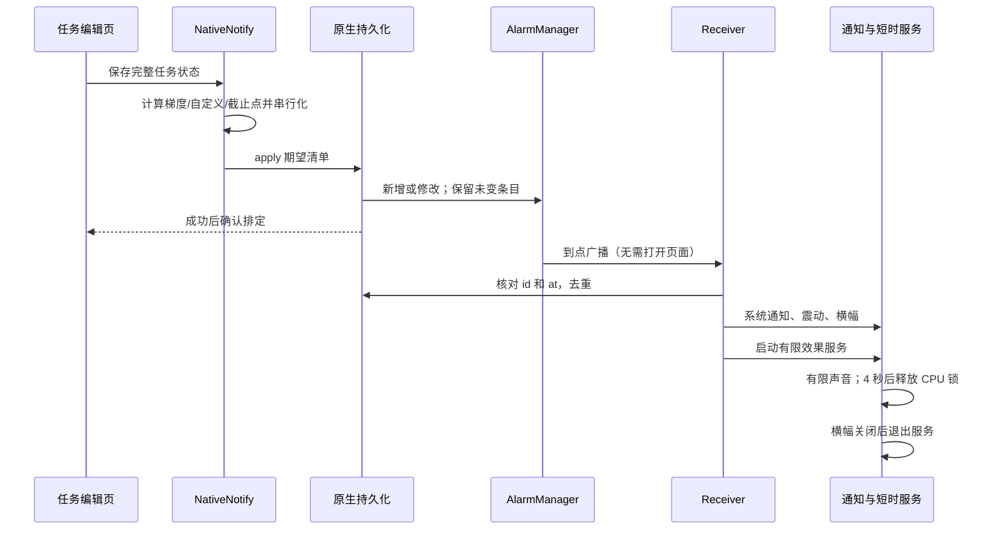

# 架构与验证边界

## 一次真实提醒

正常任务的 120 / 60 / 30 / 5 分钟梯度、自定义点与截止提醒均走这条链路。5 秒测试只向相同清单加入一个事件，不另建特殊派发路径。已经过去的梯度不作为新闹钟排入；前台补弹使用 15 分钟窗口和原生投递日志避免重复。

同步签名包含任务、课表、设置、时间档与测试时间。原生 apply 成功后才记签名；并发保存串行提交。图片原文不进入提醒诊断；诊断记录阶段、时间、进程号、错误，最多 60 条。

## 生命周期与省电

未来事件交给系统，不启动常驻服务。广播先同步完成核心通知，再启动短时效果服务，避免服务启动失败吞掉通知。手动保留的横幅可保留进程服务，但不持有 CPU 锁；关闭横幅后退出。播放器有限且设置失败超时，尊重手机音量/勿扰。

`setAlarmClock` 不受普通闹钟的 Doze 延迟，但系统会在接近闹钟时退出休眠。`setExactAndAllowWhileIdle` 可以在 Doze 中派发，仍受频率等限制；不能简单描述为“只在维护窗口派发”。ROM 行为必须通过真实设备诊断确认。[Android 电源说明](https://developer.android.com/training/monitoring-device-state/doze-standby)

WebView 不再调用全局 `pauseTimers()` 截断正在等待的桥接确认；隐藏页面不执行提醒计算或重绘。前台更新最多每 12 小时查询一次，没有后台更新任务。

## 课表与 OCR

ML Kit 离线中文模型 → 带坐标的块/行 → 星期与节次定位 → 课程标题与教室/备注区分 → 相邻重复课程格合并 → 核对页 → 批量导入。原图样本在 androidTest assets，既不打入生产 APK，也不上传 OCR 服务。完整流程验收 13 个上课时段，包括周三 7–9 节跨三行课程。小字仍可能有误：原图中的太极拳字形及机房范围数字会标为待核对，测试明确检查该标记，不能把结构正确描述为文字百分之百正确。准确的一键参考数据单独核对与测试。

一键参考课表与 OCR 是两个明确入口：前者是用户提供课表的人工核对数据，后者对任意照片执行通用识别。参考数据不假装是 OCR 识别结果。截图没有作息时刻，不覆盖用户已有作息；习题课备注不自动生成为额外课程。

## 更新

本地安装 build 与多源远端 build 比较 → 常驻应用内更新选择 + 每版一次系统通知 → 用户选择后原生下载 → Android 安装确认。仅发现版本不自动下载或安装；离线自动检查保持安静，手动检查显示错误。构建号单调递增，CDN 包使用版本化文件名减少旧缓存。

## 测试边界

Web VM 检查逻辑和表单，不模拟真实安卓通知。Instrumentation 启动真实 WebView、经过实际 save / Capacitor / AlarmManager；不缩短生产五分钟梯度常量，实际等待梯度与截止。播放器检查开始/完成，不能证明用户静音模式下有声。冷进程检查系统能重新派发；临近 AlarmClock 可能阻止模拟器进入深度 Doze，记录达到的状态，不能声称没达到的深度已通过。

每次失败都上传 trace、logcat、系统闹钟/服务/窗口状态、OCR JSON 和截图。OPPO 真机仍需桌面、锁屏、系统清理后的场景验证；Android “强行停止”与普通退到桌面是不同状态。
