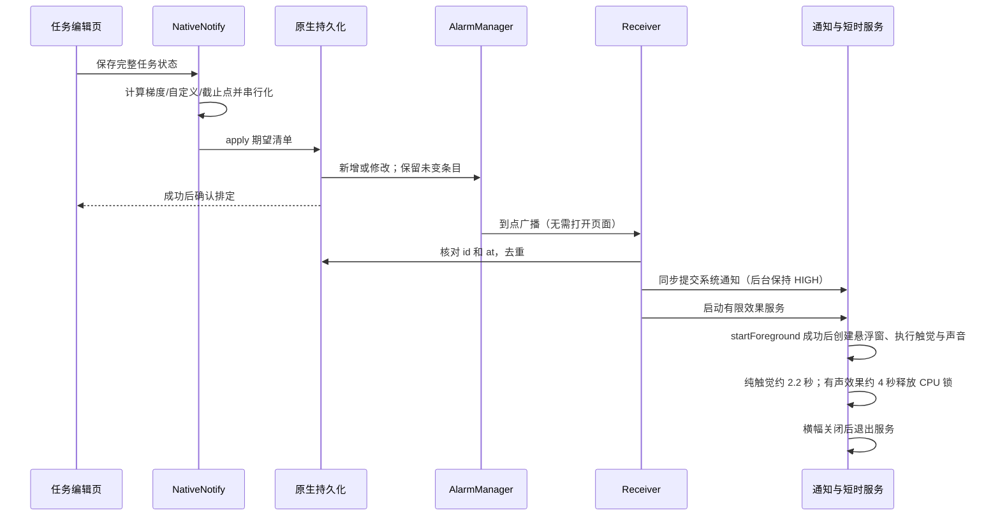

# 架构与验证边界

## 一次真实提醒

正常任务的 120 / 60 / 30 / 5 分钟梯度、自定义点与截止提醒均走这条链路。5 秒和 60 秒测试只向相同清单加入一个事件，不另建特殊派发路径。已经过去的梯度不作为新闹钟排入；前台补弹使用 15 分钟窗口和原生投递日志避免重复。

同步签名包含任务、课表、设置、时间档与测试时间。原生 apply 成功后才记签名；并发保存串行提交。图片原文不进入提醒诊断；诊断记录阶段、时间、进程号、错误，最多 60 条。

## 静音、触觉与声音（v2.3.3）

手机系统静音不等于应用的 `remindSilent`。前者默认保留震动，可用 `vibrateInSilent=false` 单独关闭；后者关闭全部提醒输出并清除原生排期。总震动开关关闭时，静音震动偏好不会重新打开震动。

`vibrateInSilent` 默认 true，进入每条任务梯度、截止、课程及测试的持久化 JSON 和 PendingIntent extras。同步签名包括此偏好；`SCHED_VER=14` 重排升级后的记录。原生重启/更新恢复使用存储值，周期续排复制原记录，旧数据缺少该字段时按 true 读取。

接收器按照到点时的手机状态选择输出。仅系统为 `RINGER_MODE_SILENT`、勿扰为 ALL 且静音震动开启时，有限服务用 `USAGE_ALARM` 请求纯触觉波形；不创建闹钟音频、不调音量、不设置策略绕过 flags。非静音的原生触觉用 `USAGE_NOTIFICATION`。NONE/ALARMS 勿扰直接抑制；静音下 PRIORITY 也抑制，不将触觉提升为 ALARM；非静音下 PRIORITY 继续受通知策略约束。

持久化通道继续表示应用的响铃、震动与横幅选择；系统静音时仅将实际通知转到 v6 quiet 通道。共 14 个通道：8 个 v4、4 个 v5、2 个 quiet。quiet 不产生通道震动，高重要性通道使用无声 PCM 保留系统横幅资格，普通通道不带声音；实际是否弹出仍由系统控制。原生直接触觉与通知通道触觉只选择一个产生源，避免重复。

`ReminderSound` 另行检查应用响铃选择、NORMAL 铃声模式、正通知音量及 ALL 勿扰，满足后才以 `USAGE_NOTIFICATION` 播放有限提示音。系统静音绝不因此发声；触觉的 ALARM 用途不改变播放器的用途或条件。

用户提供的 b82 诊断证实旧版在 `ringerMode=0`、通知音量 0、勿扰 ALL 时以 `ringer_silent` 主动提前返回，尚未调用震动 API。v2.3.3 区分 `blocked_preference`、`blocked_policy` 和真实请求，并记录 `lastVibrationUsage`；API 返回成功仍不代表 OPPO 硬件已产生可感知震动。

## 生命周期与省电

未来事件交给系统，不启动常驻服务。广播先同步完成核心通知，再按需启动短时效果服务，避免服务启动失败吞掉通知。纯触觉约 2.2 秒释放，有声效果约 4 秒释放；手动保留的横幅可保留进程服务，但不持有 CPU 锁，关闭横幅后退出。播放器有限且设置失败超时，尊重手机音量/勿扰。不关闭省电模式、不申请电池白名单，不增加后台轮询或长期唤醒锁。

`setAlarmClock` 不受普通闹钟的 Doze 延迟，但系统会在接近闹钟时退出休眠。`setExactAndAllowWhileIdle` 可以在 Doze 中派发，仍受频率等限制；不能简单描述为“只在维护窗口派发”。ROM 行为必须通过真实设备诊断确认。[Android 电源说明](https://developer.android.com/training/monitoring-device-state/doze-standby)

WebView 不再调用全局 `pauseTimers()` 截断正在等待的桥接确认；隐藏页面不执行提醒计算或重绘。前台更新最多每 12 小时查询一次，没有后台更新任务。

## 页面操作与可读性

`gestures.js` 监听触摸事件，通过既有页签按钮切换页面；输入控件、弹层、课表横向区域、文字选择及系统边缘返回手势不参与切页。模块自身不写任务或课表数据，不创建计时轮询。

`readability.js` 在页面初始化和皮肤/壁纸更新时计算派生 CSS 颜色，使用签名跳过未变化的重复计算；只调整展示变量，不改保存的皮肤配色或业务数据。照片壁纸下保留透明日历与标题；通过缩略亮度缓存，对可见文字位置做局部采样，调节白字阴影与薄遮罩，避免整块不透明底。按钮独立选择对比色。图片与布局变化时更新，不使用后台轮询。

## 课表与 OCR

ML Kit 离线中文模型 → 带坐标的块/行 → 星期与节次定位 → 课程标题与教室/备注区分 → 相邻重复课程格合并 → 核对页 → 批量导入。原图样本在 androidTest assets，既不打入生产 APK，也不上传 OCR 服务。完整流程验收 13 个上课时段，包括周三 7–9 节跨三行课程。小字仍可能有误：原图中的太极拳字形及机房范围数字会标为待核对，测试明确检查该标记，不能把结构正确描述为文字百分之百正确。准确的一键参考数据单独核对与测试。

一键参考课表与 OCR 是两个明确入口：前者是用户提供课表的人工核对数据，后者对任意照片执行通用识别。参考数据不假装是 OCR 识别结果。截图没有作息时刻，不覆盖用户已有作息；习题课备注不自动生成为额外课程。

## 更新

本地安装 build 与多源远端 build 比较 → 常驻应用内更新选择 + 每版一次系统通知 → 用户选择后原生下载 → Android 安装确认。仅发现版本不自动下载或安装；离线自动检查保持安静，手动检查显示错误。构建号单调递增，CDN 包使用版本化文件名减少旧缓存。

## 测试边界

Web VM 检查逻辑和表单，不模拟真实安卓通知。Instrumentation 启动真实 WebView、经过实际 save / Capacitor / AlarmManager；不缩短生产五分钟梯度常量，实际等待梯度与截止。播放器检查开始/完成，不能证明用户静音模式下有声。冷进程检查系统能重新派发；临近 AlarmClock 可能阻止模拟器进入深度 Doze，记录达到的状态，不能声称没达到的深度已通过。

每次失败都上传 trace、logcat、系统闹钟/服务/窗口状态、OCR JSON 和截图。OPPO 真机仍需桌面、锁屏、系统清理后的场景验证；Android “强行停止”与普通退到桌面是不同状态。

## 后台显示与证据（v2.3.4）

`SYSTEM_ALERT_WINDOW` 已授予仅说明可以尝试添加窗口，不证明 ColorOS 最终合成显示。旧版在亮屏且权限允许时预先将 high 改成 gentle，造成悬浮窗被隐藏时系统横幅也失去资格。现在仅 `MainActivity.visible` 为 true 时减少重复；后台一律保留原来的 high/gentle 偏好，静音时仍保持对应 high/gentle quiet 通道。

系统通知在广播接收器内先提交，悬浮窗只在 `AlarmService.startForeground` 成功后创建。服务无法启动不会撤掉已经提交的系统通知。系统通知是否真正弹横幅由系统通知设置、勿扰和 ROM 决定；高重要性不能当作用户已看见。自定义卡片初期可能被系统横幅遮挡，因此真实桌面截图检查在手动保留的卡片上进行，自动五秒用例分别检查系统通知、创建与撤销时刻。

锁屏页面取消永久保持亮屏标志，自动模式五秒退出；手动模式允许系统按原超时熄屏。没有新的省电白名单或权限。

诊断完整记录仍在本地，复制时使用小于 4500 字符的完整 JSON，最近事件优先。用户提供的 b86 附件归一化换行后恰好 5000 字符且在 JSON 中间结束，应用原剪贴板实现未发现此上限，因此只将其判为输入/传输截断的证据，不声称原生没有执行缺失的阶段。

[Android 通知通道](https://developer.android.com/develop/ui/compose/notifications/channels) · [TYPE_APPLICATION_OVERLAY 的系统可见性控制](https://developer.android.com/reference/android/view/WindowManager.LayoutParams#TYPE_APPLICATION_OVERLAY) · [精确闹钟的后台服务启动例外](https://developer.android.com/develop/background-work/services/fgs/restrictions-bg-start)
